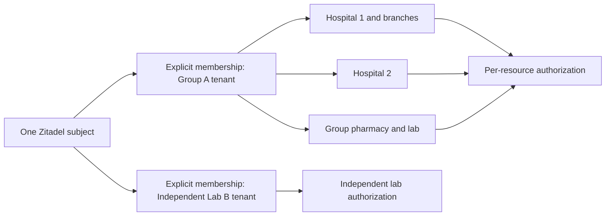

# ADR 0003: Private runtime onboarding and retained configuration

Status: accepted; supersedes ADR 0002's rejection of all customer CRDs.

The operator now manages private runtime organization claims created by the
onboarding API. Customer claims never enter the public infrastructure repository.
The API, not a hospital browser, holds narrowly scoped Kubernetes create/get
permission. Neither customers nor the API can change project/application/machine
claims or their status. Projects remain platform-owned GitOps configuration.

Assumptions to validate: onboarding bursts at most 1/s, payloads under 8 KiB,
100 organizations at 12 months and 1,000 at 36 months. Monthly 8 KiB intent plus
receipt revisions are under 0.6 GiB at 36 months. Initial completion targets
p99 under two minutes while dependencies are healthy; each controller attempt
has a 30-second deadline. Existing sign-in is independent of provisioning.
The Kubernetes controller provides durable retries; no second workflow engine
is needed for this desired-state reconciliation. Remote operations never run
inside the product database transaction.

Assets are clinical isolation, identity-administrator privileges, credentials,
and the historical onboarding record. Threats include unauthenticated callers,
a user from another hospital, a compromised product backend, and an accidental
operator retry. Authentication is checked at every service boundary. Product
callers are scoped from their verified principal; adoption of existing tenant
IDs is platform-only. Internal activation requires exact service accounts and
explicit audiences in Kubernetes TokenReview. Existing customer identities,
subjects and clinical tenant UUIDs remain stable.

## Organization boundaries and shared people

| Scenario | Identity and product boundary |
| --- | --- |
| One independently administered hospital | One Zitadel organization and stable Helivanta tenant UUID |
| Hospital group with branches | One organization/tenant where governance is shared; separate hospital and branch records with resource permissions |
| Group-owned pharmacy or lab | Resources in that tenant, with explicit pharmacy/lab/hospital permissions |
| Independent pharmacy or lab | Its own organization and tenant; relationships grant no automatic clinical access |
| Group with autonomous subsidiaries | Separate organizations/tenants; the product explicitly authorizes cross-tenant workflows |
| Clinician working in several hospitals/groups | One home Zitadel subject, explicit memberships and hospital grants in each tenant; context switching rechecks membership |

A shared login is not shared data access. Changing an org hint, email suffix,
URL, product role claim or selected hospital must never create membership.
Identity administration (live ORG_OWNER membership) differs from clinical
`tenant_admin`, which differs from per-hospital/pharmacy/lab permissions.
A clinical tenant administrator is deliberately a group-wide role; grant narrower
roles/resource access to staff who should only see a branch. A user's home-org
login/MFA policy continues to apply when they access another hospital. A grant
to the shared Helivanta project permits authentication, not patient access.
No per-hospital OAuth clients or projects are created. New independent
organizations receive the explicitly requested initial owner at creation;
adoption does not add or change organization owners.

## Durable forward recovery

1. API authenticates and authorizes caller, derives new tenant UUID from the
   caller and idempotency key, or validates a platform-authorized adoption.
2. API creates an immutable private ZitadelOrganization. A conflicting replay
   is refused; the same request returns the same identity.
3. Controller writes held intent YAML before remote mutation. New organizations
   use a deterministic ID. Adoption requires matching existing tenant metadata.
4. Controller validates active verified initial human, product ownership and
   active organization; creates the grant and strict new-org policy. It never
   deletes identities, overwrites a tenant binding, reactivates inactive state,
   changes existing memberships, or trusts a claimed domain.
5. Onboarding API authenticates controller, checks the stored claim and live
   Zitadel proof, commits the existing UUID/projection/entitlement with audit,
   then calls Helivanta over HTTPS with a distinct projected service token.
6. Helivanta accepts only onboarding-api's audience-bound service identity.
   In an RLS-scoped transaction it bootstraps the first tenant administrator and
   outbox event. An existing tenant must already have that exact administrator.
   After commit it reconciles permission, role and tenant tuples. A persistent
   activated marker prevents completed claims from recreating revoked final
   membership; initial administrator creation is only for a new pending tenant. External
   failures leave pending; retries preserve existing rows and repair tuples.
7. Controller writes held completion YAML, then marks Ready/current. Archive,
   identity, API, database or OpenFGA failures prevent completion. Later drift
   checks reuse the immutable recorded archive revision and recheck identity
   and activation. Deleting a claim never deletes its remote org or archive.

## Retention and recovery

GCS uses private uniform IAM, public-access prevention, object versioning,
conditional generation-zero creates, append-only content-addressed revision
paths, a minimum six-year retention policy and an event-based hold on each
object. There is no expiration lifecycle. The workload gets only create/get
for the exact product/environment prefix, with no update/delete/hold-release.
Terraform prevents bucket destruction. An administrator who controls IAM can
still release holds after the retention minimum; this is not a claim of
absolute undeletability. No irreversible retention lock is applied implicitly.
Records contain configuration identifiers and subject IDs, never credentials,
patient records or clinical payloads. Credentials stay in OpenBao.

Restore by reading a pinned GCS generation, verifying its hash/binding, and
recreating the private claim through an authorized recovery workflow. The
controller re-reads/reuses existing identities and verifies held objects.
Proposed RPO is zero for completed records and RTO one hour; restore drills and
production observations are required evidence, not established by unit tests.
Approximate standard storage cost at the stated volume is cents/month; cloud
operations, audit retention and retries are additional. No new compute service
is introduced. Retained configuration includes identifiers, so legal retention
and access review remain required.

## Migration and rollback

Adopt YES HOSPITAL's current organization and UUID, using its existing clinical
administrator. Preserve all clinical rows and other memberships. Adopt the
Helivanta project/client unchanged before considering a project-wide org gate.
Do not move users between directories or migrate clinical data for this change.
Policies inherited by existing orgs may be preserved during a staged MFA
cutover; such an org is not evidence that MFA is enforced. No global policy
change is authorized by a customer claim.

Deploy additive CRDs/RBAC and application endpoints before enabling organization
provisioning. Disable the organization controller to stop new remote writes;
roll back images independently of additive claims. Do not remove a credential
source until readers, recovery and cold start are proven. Offboarding requires
stopping the desired-state claim before revoking grants so drift reconciliation
cannot restore them; use the existing audited revocation workflow and retain
the configuration record. Automated clinical offboarding is outside this flow.
